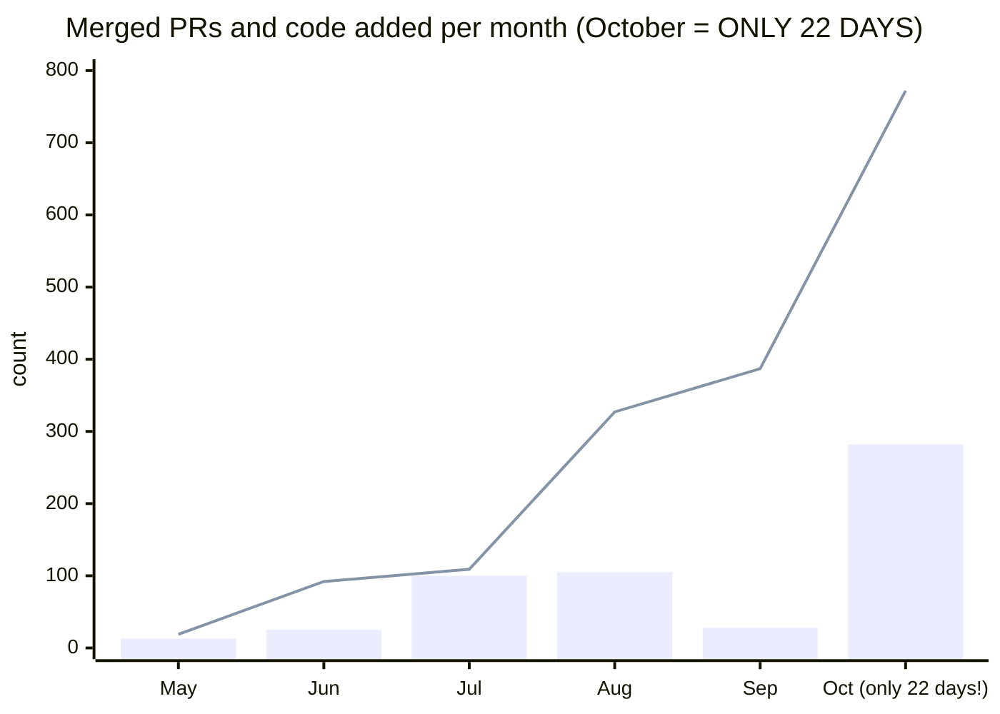

# jstack: Claude Code skills for parallel AI coding agents on one laptop

[](#quickstart)
[](skills)
[](https://github.com/jayjayholic/jstack/stargazers)
[](CHANGELOG.md)

Claude Code skills and scripts for people running a bunch of parallel AI coding agents, each in its own git worktree, on one machine. Their branches ship as a train: one build, one PR, one CI run. One machine-wide lock and a hard RAM ceiling keep builds from eating all your RAM (Turbopack, I'm looking at you). `/train-queue` tells you where everything is. Plus `/optimize`, a speed agent that proves its fixes with A/B stats.

```text
/plugin marketplace add jayjayholic/jstack
/plugin install jstack@jstack
```

Or tell your agent "follow ADAPT.md in jayjayholic/jstack for my project". Every rule in here exists because something broke, usually my laptop.

> Made by João Lima ([@jayjayholic](https://github.com/jayjayholic)) while building [Hakutaku](https://hakutaku.ai). Most of the rules were written by the agents themselves, right after they broke something.

Curious how the rest of the work happens before a branch ever boards a train? That's in [HOW-I-WORK.md](HOW-I-WORK.md).

## Before you start: plan first, and bring big rate limits

**This is for detailed, planned work.** jstack is the shipping end. It doesn't make vague ideas faster, it makes planned ones land. So before any agent touches code:

1. Grill the plan with [/grill-me](skills/grill-me) until it stops having holes.
2. Map it with [/wayfinder](skills/wayfinder): a map, a ledger of every surface the change touches, and tickets with their dependencies and the files each one owns.
3. Prototype the UI before writing tickets for it.
4. Only then let the agents loose.

The ticket dependency graph is what makes the chains possible (one agent per chain, see the rules below), and chains are what keep ticket time down. Honest lesson from the night these rules came from: the UI that was planned and prototyped flowed. The process changes I improvised live, mid-run, cost rework. Plan the work AND the process, then leave both alone.

**Bring high usage limits.** With 10 to 13 agents in parallel, lower plans hit rate limits and agents die mid-task. That night agents died on limits and on account switches and had to be resumed one by one. I recommend a Claude Max 20x plan, or anything with equally high limits. My laptop already crashes enough, it doesn't need help from the rate limiter.

## Did it actually work? The numbers

Same developer, same repo, 4 May to 22 Oct 2026. Merged PRs, plus lines of code added (no Markdown, lockfiles, generated code or binaries).



Bars are merged PRs, the line is thousands of lines of code added. And yes, October is only 22 days. The last 4 of those did most of the damage.

| | Before (4 May to 20 Sep) | After (19 to 22 Oct) | Change |
|---|---|---|---|
| Merged PRs per day | 1.9 | 46.5 | **+2,300%** |
| Lines of code added per day | 4,204 | 75,600 | **+1,700%** |
| Code in the repo | 219k lines (May) | 1.23M lines | **5.6x** |

"Before" is one agent at a time with no planning skills. "After" is wayfinder plans, agents in parallel worktrees, trains and chains. The laptop survived. Mostly.

Speed is cheap if stage is on fire, so here is the quality side:

- **0** red pushes to stage since trains started: every train merged only on zero failed CI checks.
- **22** trains in two days, each typechecked and run through the full suites first (6,655 bun tests and 1,214 vitest tests passing).
- **87** UI tickets planned as one map of 284 screens and features, each shipped with its own tests, a layout and contrast audit, and a pixel check against the approved prototype.
- **1** stage deploy failed in two days, and it was an upload filter, not code. Fixed in 11 minutes.

Not counted in the numbers above: the same weeks also shipped security hardening (role checks, per-tool consent rules, key revocation, rate limits and bot checks on public pages) and speed work on the app and on agent replies (median reply went from 24.9 s to 20.0 s on a real user's replayed turns).

Fine print, because I like being believed: about one branch in four failed the train's typecheck the first time and went back to its agent. The gates caught it before stage, which is the whole point. Agents also commit in smaller pieces than a human, so commit counts would inflate the jump even more; I left them out on purpose. Merged PRs are the fair number.

## The short version

Eight agents finish their branches at the same time. If each one opens its own PR, that's eight builds and eight CI runs. My laptop gives up around build three.

So the agents don't build anything. Ever. They run their own tests, one typecheck in a small lane of their own, screenshot their UI on a component gallery and say they're ready. Then one orchestrator agent merges all the ready branches together, typechecks once, opens one PR and merges it if nothing is red. If your staging deploy runs a real build, that deploy is the build check, and the laptop only builds when the deploy fails.

Builds and full typechecks share one slot for the whole machine. Only one of them runs at a time, and it runs under a hard RAM ceiling, so the worst case is a dead build instead of a dead laptop.

## Why I made this

I build a lot of features at once. Prototype, check the UI, test it live, move on. Almost all of the code comes from Claude Code agents running in parallel, each one in its own git worktree.

GitHub's normal flow doesn't like that. One PR per feature means one CI run per feature, one full build per feature, one merge conflict per feature, and me babysitting all of it. That flow makes sense for one person opening one PR. With eight agents finishing at once it turns into a traffic jam. I'm honestly hating working with GitHub this way. The checks are fine, the one-PR-per-branch shape is what hurts.

So I stopped shipping branches one at a time and started shipping trains.

## My machine

| | |
|---|---|
| Machine | Avell STORM TWO laptop |
| CPU | Intel Core i7-12700H (14 cores / 20 threads) |
| RAM | 32 GB (keep this number in mind) |
| GPU | NVIDIA RTX 3060 Laptop + Intel Iris Xe |
| Disks | Sabrent Rocket Q 2 TB NVMe + 256 GB NVMe |
| OS | Windows 11, Git Bash + PowerShell, Bun, Docker/WSL |
| Stack | Next.js 16 (Turbopack), TypeScript, tRPC, Prisma, Postgres |

32 GB felt like a lot. Then six agents each decided to "just run a quick `next build`". One Turbopack build eats about 5 GB and ignores `--max-old-space-size`. A full `tsc` is about 4 GB, a `next start` 1 to 2 GB. Three builds plus two typechecks and the laptop doesn't get slow, it just turns off. It crashed three times in one day while I was writing these rules. My laptop is not a fan of parallelism.

Then I fixed all that, ran one single build alone, and free RAM still hit 2%. Turns out `next build` quietly spawns one worker per CPU core minus one. On a 20-thread laptop that's 19 workers at 0.75 GB each. Nineteen. My laptop has fewer friends than that build had workers.

## How a train works

```
 agent A ─┐  own worktree, typecheck + own tests
 agent B ─┼─ READY FOR BUILD ──►  orchestrator
 agent C ─┘                           │
                                      ▼
               fresh stage + merge A, B, C   (one train worktree)
                                      │
               one typecheck (+ build if needed) (holds the heavy slot, capped)
                                      │
               one PR ─► zero failed checks ─► merge ─► deploy Ready
                                      │
               meanwhile the next train is boarding
```

1. Agents work in parallel, each in its own worktree. They check their work with typecheck and their own tests. They never run a build just to verify.
2. When an agent is done it sends `READY FOR BUILD: <worktree> - <title> - typecheck green at <sha>` to the orchestrator. No sha, no boarding.
3. The orchestrator merges every ready branch onto a fresh `stage` in one train worktree, runs one quick incremental typecheck (plus one build if nothing else builds it), opens one PR, merges it only if zero checks failed, and tells me when the stage deploy is live. A branch that breaks the typecheck gets dropped and sent back with its errors. The train doesn't wait for it, the fix catches the next one.
4. While one train sits in CI, the next one boards, and it's already merged and typechecked by the time the first one lands. Two trains max: one moving, one boarding. More than that and you're just running a parking lot.

One build can check ten branches. That's why this works on a laptop.

If there's only one branch and nothing else going on, skip the train and open a normal PR. A train with one wagon is just a PR with extra paperwork.

## What's in the repo

```
.claude-plugin/          Claude Code plugin + marketplace manifests (/plugin marketplace add jayjayholic/jstack)
AGENTS.md                notes for coding agents installing or changing this repo
llms.txt                 a short index of the docs, for LLMs
ADAPT.md                 step by step guide (for your agent, or you) to fit jstack to your stack
HOW-I-WORK.md            the rest of my workflow: grilled plans, two-arm research, prototypes, A/B everything
skills/train/
  SKILL.md               the /train skill: when to train, how to brief agents, the gates, and the Lessons log
  orchestrator-brief.md  the prompt for the one orchestrator agent
  worker-clause.md       the block pasted into every coding agent's prompt (build rules + READY format)
skills/train-queue/
  SKILL.md               the /train-queue skill: one status board (live, in flight, queue, what each agent is doing)
skills/optimize/
  SKILL.md               the /optimize skill: the speed agent. Measures the built app and staging, fixes the top cost, proves it with A/B stats
skills/grill-me/         /grill-me, from mattpocock/skills (MIT, LICENSE inside): just calls /grilling
skills/grilling/         /grilling, from mattpocock/skills (MIT): asks hard questions in rounds until the plan has no holes
skills/wayfinder/        /wayfinder, from mattpocock/skills (MIT): turns a big plan into a map of decision tickets
skills/research/         skills/prototype/         | what /wayfinder calls, also from mattpocock/skills (MIT), copied as-is
skills/domain-modeling/   | so nothing else needs installing. setup-matt-pocock-skills
skills/setup-matt-pocock-skills/ /  tells wayfinder where your issue tracker lives
skills/simplify/
  README.md              /simplify is built into Claude Code, so this is only a pointer (its licence doesn't allow a copy)
tools/
  config.example.sh      every setting in one file; copy it to ~/.jstack/config.sh
  jstack-env.sh          loads your config and fills in defaults (the other scripts source it)
  heavy-lock.sh          ONE machine-wide slot for heavy jobs (build, typecheck) + server_wait + heavy_capped (hard RAM ceiling)
  run-capped.ps1         Windows Job Object: the whole build process tree gets a RAM ceiling, past it the build dies, not the PC
  coordinator-build.sh   one build at a time, waits for free RAM
  train.sh               assemble / build / ship a train, merges only when every check is green
  new-worktree.sh        one worktree per agent, like a fresh clone (copies local env files, reuses generated code from a sibling)
  node-memory-watch.ps1  the bouncer: when RAM runs out, kills the fattest node/bun process (never your agent CLI) before Windows does something worse
```

Every agent gets its own worktree from `new-worktree.sh`, so eight of them can edit the same repo without stepping on each other. The memory watcher is the last line of defense. It's not pretty, but a killed build beats a frozen laptop and a zeroed `.git/config` (yes, that happened).

## Quickstart

The plugin way: run the two `/plugin` lines at the top, then put your values in `~/.jstack/config.sh` (copy `tools/config.example.sh`). The skills show up as `/jstack:train`, `/jstack:train-queue`, `/jstack:optimize`, `/jstack:grill-me`, `/jstack:grilling` and `/jstack:wayfinder` (plus the skills wayfinder calls: research, prototype, domain-modeling, setup-matt-pocock-skills). `/simplify` is already in Claude Code.

The lazy way: clone it and tell your coding agent "follow ADAPT.md in jstack for my project at <path>". It detects your stack, fills in the settings, installs everything and checks it works. That's what I'd do.

The hands-on way:

1. Clone it.
   ```bash
   git clone https://github.com/jayjayholic/jstack.git
   ```
2. Copy the tools somewhere that won't move, and make your config.
   ```bash
   mkdir -p ~/jstack-tools ~/.jstack && cp jstack/tools/* ~/jstack-tools/
   cp ~/jstack-tools/config.example.sh ~/.jstack/config.sh   # then edit it
   ```
3. Install the skill for Claude Code. This is user-wide; for a single project use `<your-repo>/.claude/skills/` instead.
   ```bash
   mkdir -p ~/.claude/skills && cp -r jstack/skills/train jstack/skills/train-queue ~/.claude/skills/
   cp -r jstack/skills/{grill-me,grilling,wayfinder,research,prototype,domain-modeling,setup-matt-pocock-skills} ~/.claude/skills/   # the planning ones, nothing to fill in
   ```
4. Fill the `{{PLACEHOLDERS}}` in the installed skill files (the table in [ADAPT.md](ADAPT.md) says what each one is). When `grep -rn "{{" ~/.claude/skills/train ~/.claude/skills/train-queue` prints nothing, you're done.
5. Paste `worker-clause.md` into every coding agent's prompt. `/train` hands `orchestrator-brief.md` to the one agent that runs trains.
6. Use the lock yourself too.
   ```bash
   source ~/jstack-tools/heavy-lock.sh
   heavy_acquire my-build; heavy_capped "npm run build"; heavy_release   # anything heavy, under the RAM ceiling
   server_wait 8                                          # before a server: no build running and 8 GB free
   ```
7. When two or more branches are ready, type `/train`.

## Settings

The scripts don't have my paths in them anymore. Every setting is an env var with a default, and `~/.jstack/config.sh` is where you set yours. The skill files use `{{PLACEHOLDERS}}` for the same values, since they're prompts and not scripts. The full list, with how to find each value, is in [ADAPT.md](ADAPT.md).

My own config, as an example:

| Setting | Mine |
|---|---|
| `JSTACK_LOCK_DIR` | a folder next to my repos, shared by every agent |
| `JSTACK_INTEGRATION_BRANCH` | `stage` (production only gets release PRs) |
| `JSTACK_INSTALL_CMD` / `JSTACK_CODEGEN_CMD` | `bun install` / `bun run db:generate` |
| `JSTACK_TYPECHECK_CMD` | `bun run typecheck` |
| `JSTACK_BUILD_CMD` | `rm -rf .next && bunx next build --turbopack` |
| `JSTACK_LOCAL_ENV_FILES` / `JSTACK_LOCAL_DIRS` | my env files / `.vercel` |
| `JSTACK_MIN_FREE_GB` | `8` |
| `JSTACK_CAP_GB` | `12` (my build died at 6 and 8, the ceiling counts committed memory) |
| `JSTACK_BUILD_ENV` | `CIRCLE_NODE_TOTAL=5` (Next.js reads it and uses 4 build workers instead of 19) |
| `JSTACK_TRAIN_BUILD` | `deploy` (stage builds on every merge anyway, so the laptop doesn't have to) |
| `JSTACK_CODEGEN_INPUTS` / `JSTACK_CODEGEN_REUSE_PATHS` | my schema folder + lockfile / the generated client folder |
| `node-memory-watch.ps1` | `-LimitGB 5 -PressurePercent 95`, running in a background PowerShell |

## Rules that exist because something broke

The full list with dates is in the Lessons section of `skills/train/SKILL.md`. The big ones:

- One heavy slot for the whole machine. Builds and full typechecks wait for the same lock. Before this, the train had its own lock and the agents had two more, so three Turbopack builds ran at once and the PC crashed. Twice.
- Only builds and typechecks hold the slot. Agents grabbed it for screenshot runs and "proofs" and trains sat in line for half an hour behind a screenshot. Servers and proofs use `server_wait`.
- Agents never build. They did about 15 production builds in one night just to take screenshots. Screenshots now happen on a component gallery: 39 seconds and under 1 GB, against 1.5 to 8 minutes and 6.5 to 9 GB for the build it replaced. Live tests happen on staging after the merge.
- Typecheck before READY, in a lane. When agents skipped it, 27% of branches broke the train. Now each one runs one typecheck in `tc_run`, two at a time max, because a `tsc` peaks around 5 GB and four in parallel took my laptop to 0.3 GB free. It survived. Barely. With feelings.
- Drop, don't fix. A branch that breaks the train gets bounced with its error lines and rides the next one. Fixing it inside the train held every other branch hostage, about 3 times the waiting.
- Cap the build's workers and put a ceiling on the whole tree. One build with 19 workers took the laptop to 2% free RAM all by itself. `CIRCLE_NODE_TOTAL=5` for Next.js, `heavy_capped` for everything.
- Build only when the deploy fails. Staging builds every merge anyway. The laptop reproduces it once, capped, only when that deploy goes red.
- Two trains max. I once had four trains queued behind each other. That's not a train system, that's a traffic jam with extra steps.
- Delete the pre-push hook if CI already runs the same thing. Mine ran a 4 GB typecheck on every push, 10 to 15 minutes each, which made `git push` a heavy job. Now a push is just a push.
- One agent per dependency chain, not per ticket. It builds the chain's tickets in order on one stacked branch and says READY after each. Merged throughput went from about 3 tickets an hour to about 27 the same night. To be fair, part of that was a pile of parallel work landing at once, so the steady number is lower. Still the best thing I did all night.
- Deploy-only failures exist. An unanchored `docs/` in `.vercelignore` stripped every `docs` folder in the tree, `src/**/docs` included, and the deploy failed while every local check was green. Anchor ignore paths to the root (`/docs/`). The deploy is the check for this kind of thing, no local build would have caught it.
- Gates before work. A UI audit added halfway through the night sent every READY branch back for rework. Write down what "done" means before the first agent starts.
- Codegen once per schema. New worktrees copy the generated client from a sibling with the same schema hash instead of regenerating it for the 30th time that day: 519 seconds down to about zero. Only from a sibling where every generated client exists and isn't empty, though. A copy grabbed mid-codegen had the right hash, half the files, and 80 type errors.
- The watch: every 15 minutes the main session checks RAM (below 5% free it kills the heaviest build, never the agent CLI), agents silent for over an hour, and servers or scripts left behind by agents that already finished. Only `running` agents count against the cap; waiting ones are parked. Agents commit as they go. And the rules stay frozen while you measure, because I changed them five times in one night and then had no idea which change helped.
- No servers next to a build. `server_wait 8` waits until no build holds the slot and 8 GB is free before any `next start`. A "screenshot build" hit 7.7 GB while another agent had a server up, and free RAM dropped to 1.8 GB.
- The stale slot race. The lock treated a slot as abandoned after 15 minutes, but a train build can take longer, so a second build started next to it. Now it's 45 minutes, and if the owner file vanishes the slot is not treated as stale.
- Merge only with zero failed checks. My merge script didn't stop on red once and merged a PR with a failing job. It was a network flake that time. I got lucky.
- Don't poll Vercel with its CLI. `vercel ls` in a loop grew to 4 GB. Poll the GitHub deployments API instead.
- GitHub webhooks can be late. During a GitHub incident, merges started no CI and no deploy for hours. Check githubstatus.com before you start blaming your own code.
- Never `git stash`. All worktrees share one stash stack, and one agent popped another agent's changes. Use WIP commits.
- A hard crash can wipe `.git/config`. Keep `[core]`, add the remote back from `FETCH_HEAD`, restore branch tracking, run `git fsck`.
- Rate limits hit every agent at the same moment. Resume each one after, and the orchestrator rebuilds whatever got cut off.

## Measure it

Two formulas I should have used on day one.

- **Little's law, L = λ·W.** Work in flight equals merge rate times lead time. One night I merged 2 tickets an hour with a lead time under 2 hours, so about 4 tickets should have been in flight. There were about 20. That means new work was waiting around 10 hours. More agents didn't make it faster, they made the line longer. Starting less made it faster.
- **Clean batch, (1 - p)^n.** With p the chance one branch breaks the train and n branches per train. At p = 0.27, a train of 8 is clean 8% of the time. At p = 0.05 it's 66%. That one table is why agents typecheck before READY, and why a broken branch gets dropped instead of fixed in place.

And CI was busy only a third of the night, so CI was never the bottleneck. My laptop and my enthusiasm for starting things were. Section 7 of the train skill has the details.

## FAQ

**Do I need Next.js?**
No. The point is one heavy slot and one build for many branches. Set `JSTACK_BUILD_CMD` to whatever your expensive step is. Cargo, Gradle, Docker builds, all welcome. They eat RAM too.

**Does it run on macOS or Linux?**
Yes. The lock is plain bash and `mkdir`, and the free RAM check reads `/proc/meminfo` on Linux, `vm_stat` on macOS and PowerShell on Windows. The memory watcher is Windows-only, and the hard RAM ceiling is only tested on Windows (see the RAM ceiling question below).

**What if one branch breaks the train?**
The orchestrator throws the whole train away, pushes nothing, finds the branch the error points to, tells its agent, and rebuilds without it. A bad branch slows the train down but never ships.

**Why did `git push` use to take the lock?**
My pre-push hook ran a full typecheck, about 4 GB, so a push was a heavy job. CI already runs that typecheck, so I deleted the hook. `train.sh` still takes the slot for a push if it finds a pre-push hook, in case yours is still there.

**Does the RAM ceiling work on Linux and macOS?**
Windows: yes, tested, it's a Job Object. Linux: `heavy_capped` uses `systemd-run --user --scope -p MemoryMax`, which should work but nobody has run it yet, so test it first (ADAPT.md has a one-liner). macOS: no tree-wide cap exists that I trust, so it runs uncapped and tells you. Worker caps and the one slot still apply.

**How many agents at once?**
I run 13 on 32 GB. I once panicked and cut it to 6 after a RAM scare, then found out the culprit was one build with 19 workers. Agents that edit and test are cheap; builds are expensive. Cap the build, keep the agents. My laptop still makes some decisions for me, just fewer.

## Changelog

Each update says what changed and why. See [CHANGELOG.md](CHANGELOG.md).
