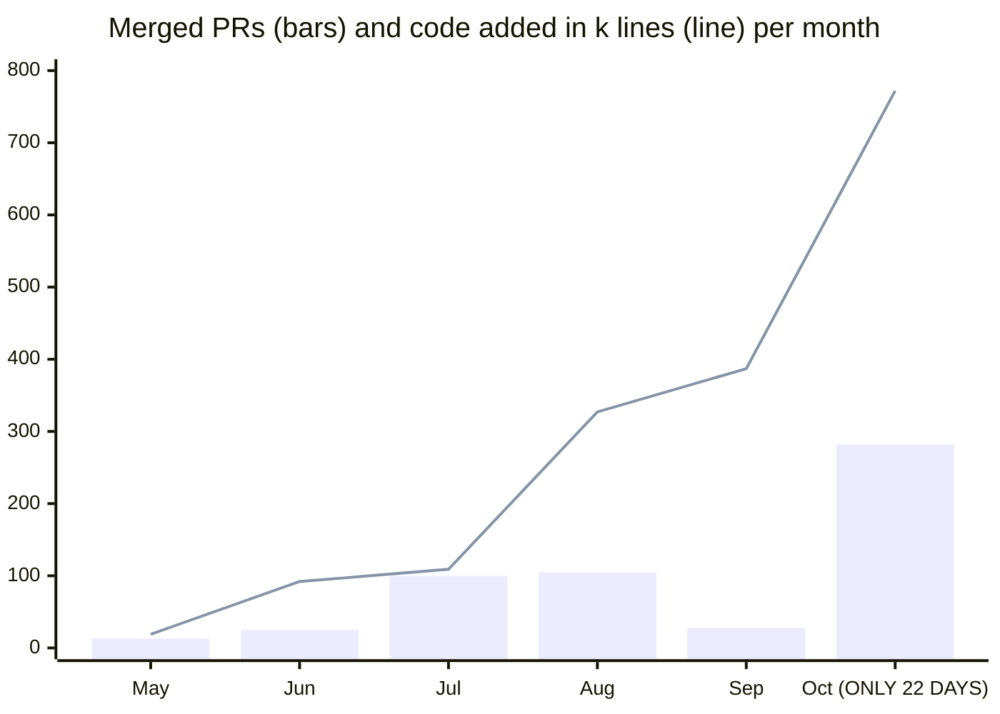

# jstack

[](LICENSE)
[](#quickstart)
[](CHANGELOG.md)
[](https://github.com/jayjayholic/jstack/stargazers)

**Claude Code skills and scripts for running 10+ parallel AI coding agents on one laptop without melting it.** Their branches ship as a train (one build, one PR, one CI run), heavy jobs share one machine-wide slot under a hard RAM ceiling, and every branch is checked before it boards. Every rule in here exists because something broke, usually my 32 GB laptop.

[Quickstart](#quickstart) · [What you get](#what-you-get) · [Merge trains](#merge-trains) · [Preflight and unslop](#think-before-prove-after-preflight-and-unslop) · [RAM](#keeping-the-ram-alive) · [Guard hooks](#guard-hooks) · [Worktrees](#worktrees-and-shared-dependencies) · [Domain packs](#domain-packs) · [Optimize](#optimize) · [Settings](#settings) · [FAQ](#faq)

## Quickstart

In Claude Code:

```text
/plugin marketplace add jayjayholic/jstack
/plugin install jstack@jstack
```

Then copy `tools/config.example.sh` to `~/.jstack/config.sh` and fill in your values (branch, build and typecheck commands, RAM limits). When two or more agent branches are ready, type `/train`.

Don't want to configure it by hand? Tell your agent: **"follow ADAPT.md in jayjayholic/jstack for my project"**. It detects your stack, fills in the settings, installs everything and checks it works. That's what I'd do.

<details>

<summary><b>Other ways to install</b> (manual copy, extra plugins, which skills show up)</summary>

**Which skills show up.** With the plugin, the skills appear as `/jstack:train`, `/jstack:train-compound`, `/jstack:train-queue`, `/jstack:optimize`, `/jstack:preflight`, `/jstack:unslop`, `/jstack:machine-memory`, `/jstack:grill-me`, `/jstack:grilling` and `/jstack:wayfinder`, plus the skills wayfinder calls (research, prototype, domain-modeling, setup-matt-pocock-skills) and the 16 `eng-*` domain packs. `/simplify` is already built into Claude Code.

**Extra plugins from the same marketplace:**

```text
/plugin install unslop@jstack                                         # /unslop:explain, /unslop:metrify, /unslop:retro
/plugin install jay-claude-switcher --marketplace jayjayholic/jstack  # account switcher side panel
```

**The hands-on way:**

1. Clone it.
   ```bash
   git clone https://github.com/jayjayholic/jstack.git
   ```
2. Copy the tools somewhere that won't move, and make your config.
   ```bash
   mkdir -p ~/jstack-tools ~/.jstack && cp jstack/tools/* ~/jstack-tools/
   cp ~/jstack-tools/config.example.sh ~/.jstack/config.sh   # then edit it
   ```
3. Install the skills for Claude Code. This is user-wide; for a single project use `<your-repo>/.claude/skills/` instead.
   ```bash
   mkdir -p ~/.claude/skills && cp -r jstack/skills/train jstack/skills/train-queue ~/.claude/skills/
   cp -r jstack/skills/{grill-me,grilling,wayfinder,research,prototype,domain-modeling,setup-matt-pocock-skills} ~/.claude/skills/   # the planning ones, nothing to fill in
   ```
4. Fill the `{{PLACEHOLDERS}}` in the installed skill files (the table in [ADAPT.md](ADAPT.md) says what each one is). When `grep -rn "{{" ~/.claude/skills/train ~/.claude/skills/train-queue` prints nothing, you're done.
5. Paste `worker-clause.md` into every coding agent's prompt. `/train` hands `orchestrator-brief.md` to the one agent that runs trains.
6. Use the lock yourself too.
   ```bash
   source ~/jstack-tools/heavy-lock.sh
   heavy_acquire my-build; heavy_capped "npm run build"; heavy_release   # anything heavy, under the RAM ceiling
   server_wait 8                                          # before a server: no build running and 8 GB free
   ```
7. When two or more branches are ready, type `/train`.

**Requirements:** `node` on the PATH (the hooks and tools), bash (Git Bash on Windows). Builds aren't tied to Next.js; see the [FAQ](#faq).

</details>

## What you get

| Area | What it does | Start with |
|---|---|---|
| [Merge trains](#merge-trains) | Many agent branches ship as one typecheck, one build, one PR | `/train`, `/train-compound`, `/train-queue` |
| [Plan first](#before-you-start-plan-first) | Grill the plan, map it into tickets with dependencies | `/grill-me`, `/wayfinder` |
| [Preflight and unslop](#think-before-prove-after-preflight-and-unslop) | Ask the right questions before coding, prove every finding after | `/preflight`, `/unslop` |
| [RAM](#keeping-the-ram-alive) | One heavy slot, a hard RAM ceiling, a memory map that names the guilty agent | `heavy-lock.sh`, `machine-memory` |
| [Guard hooks](#guard-hooks) | Hooks that block bare builds and repo-wide scans and clean up what agents leave running | `~/.jstack/guards.json` |
| [Worktrees](#worktrees-and-shared-dependencies) | One worktree per agent, shared `node_modules` | `new-worktree.sh` |
| [Domain packs](#domain-packs) | 16 packs of questions, budgets and red flags per domain | `skills/eng-*` |
| [Optimize](#optimize) | A speed agent that proves its fixes with A/B stats | `/optimize` |
| [Account switcher](#account-switcher) | Every Claude account's limits in a side panel, auto-switch at 99% | `jay-claude-switcher` |

> Made by João Lima ([@jayjayholic](https://github.com/jayjayholic)) while building [Hakutaku](https://hakutaku.ai). Most of the rules were written by the agents themselves, right after they broke something. The rest of the workflow, before a branch ever boards a train, is in [HOW-I-WORK.md](HOW-I-WORK.md).

## Why this exists

I build a lot of features at once, and almost all of the code comes from Claude Code agents running in parallel, each in its own git worktree. GitHub's one-PR-per-branch flow turns that into a traffic jam: eight agents finish, eight builds, eight CI runs, and my laptop gives up around build three. So I stopped shipping branches one at a time and started shipping trains.

Same dev, same repo, same 32 GB laptop:



<details>

<summary><b>The numbers</b> and the longer story</summary>

- **24x** merged PRs per day (1.9 to 46.5)
- **18x** code shipped per day (4.2k to 75.6k lines)
- **5.6x** codebase since May (219k to 1.23M lines)
- **87** tickets, **284** screens rebuilt in one night, every one tested and pixel-checked
- **0** broken pushes to stage, **7,869** tests green

I prototype, check the UI, test it live, move on. GitHub's normal flow makes sense for one person opening one PR: one CI run, one full build and one merge conflict per feature, and me babysitting all of it. With eight agents finishing at once that hurts. The checks are fine. The one-PR-per-branch shape is the problem.

</details>

## Before you start: plan first

jstack is the shipping end. It doesn't make vague ideas faster, it makes planned ones land. And bring big rate limits: with 10 to 13 agents, lower plans hit limits and agents die mid-task.

<details>

<summary><b>The planning steps</b> and why rate limits matter</summary>

Before any agent touches code:

1. Grill the plan with [/grill-me](skills/grill-me) until it stops having holes.
2. Map it with [/wayfinder](skills/wayfinder): a map, a ledger of every surface the change touches, and tickets with their dependencies and the files each one owns.
3. Prototype the UI before writing tickets for it.
4. Only then let the agents loose.

The ticket dependency graph is what makes chains possible (one agent per chain, see the [rules](#merge-trains)), and chains are what keep ticket time down. Honest lesson from the night these rules came from: the UI that was planned and prototyped flowed. The process changes I improvised mid-run cost rework. Plan the work AND the process, then leave both alone.

**Rate limits.** That night agents died on limits and on account switches and had to be resumed one by one. I recommend a Claude Max 20x plan, or anything with equally high limits. My laptop already crashes enough, it doesn't need help from the rate limiter. See also the [account switcher](#account-switcher).

`/grill-me`, `/grilling`, `/wayfinder` and the skills wayfinder calls come from [mattpocock/skills](https://github.com/mattpocock/skills) (MIT, licence inside each folder), copied as-is so nothing else needs installing.

</details>

## Merge trains

Agents never build. They typecheck in a small lane, run their own tests and say READY. One orchestrator merges every ready branch onto a fresh integration branch, typechecks once, opens one PR and merges on zero failed checks. One build can check ten branches. That's why this works on a laptop.

- `/train` runs a train. `/train-compound` piles many ready branches into one release that merges only when you say so. `/train-queue` prints one board: what's live, what's in flight, what's queued, what each agent is doing.
- Only one branch and nothing else going on? Skip the train and open a normal PR. A train with one wagon is just a PR with extra paperwork.

<details>

<summary><b>How a train works</b> (diagram and the four steps)</summary>

```
 agent A ─┐  own worktree, typecheck + own tests
 agent B ─┼─ READY FOR BUILD ──►  orchestrator
 agent C ─┘                           │
                                      ▼
               fresh stage + merge A, B, C   (one train worktree)
                                      │
               one typecheck (+ build if needed) (holds the heavy slot, capped)
                                      │
               one PR ─► zero failed checks ─► merge ─► deploy Ready
                                      │
               meanwhile the next train is boarding
```

1. Agents work in parallel, each in its own worktree. They check their work with typecheck and their own tests. They never run a build just to verify. UI gets screenshotted on a component gallery.
2. When an agent is done it sends `READY FOR BUILD: <worktree> - <title> - typecheck green at <sha>` to the orchestrator. No sha, no boarding. `ready-gate.sh` checks it before accepting.
3. The orchestrator merges every ready branch onto a fresh `stage` in one train worktree, runs one incremental typecheck (plus one build if nothing else builds it), opens one PR, merges it only if zero checks failed, and reports when the stage deploy is live. A branch that breaks the typecheck gets dropped and sent back with its errors. The train doesn't wait for it, the fix catches the next one.
4. While one train sits in CI, the next one boards. Two trains max: one moving, one boarding. More than that and you're just running a parking lot.

If your staging deploy runs a real build, that deploy is the build check, and the laptop only builds when the deploy fails.

</details>

<details>

<summary><b>Rules that exist because something broke</b> (24 of them)</summary>

The full list with dates is in the Lessons section of [skills/train/SKILL.md](skills/train/SKILL.md). The big ones:

- **One heavy slot for the whole machine.** Builds and full typechecks wait for the same lock. Before this, the train had its own lock and the agents had two more, so three Turbopack builds ran at once and the PC crashed. Twice.
- **Only builds and typechecks hold the slot.** Agents grabbed it for screenshot runs and "proofs" and trains sat in line for half an hour behind a screenshot. Servers and proofs use `server_wait`.
- **Agents never build.** They did about 15 production builds in one night just to take screenshots. Screenshots now happen on a component gallery: 39 seconds and under 1 GB, against 1.5 to 8 minutes and 6.5 to 9 GB for the build it replaced. Live tests happen on staging after the merge.
- **Typecheck before READY, in a lane.** When agents skipped it, 27% of branches broke the train. Now each one runs one typecheck in `tc_run`, two at a time max, because a `tsc` peaks around 5 GB and four in parallel took my laptop to 0.3 GB free. It survived. Barely. With feelings.
- **Drop, don't fix.** A branch that breaks the train gets bounced with its error lines and rides the next one. Fixing it inside the train held every other branch hostage, about 3 times the waiting.
- **Cap the build's workers and put a ceiling on the whole tree.** One build with 19 workers took the laptop to 2% free RAM all by itself. `CIRCLE_NODE_TOTAL=5` for Next.js, `heavy_capped` for everything.
- **Build only when the deploy fails.** Staging builds every merge anyway. The laptop reproduces it once, capped, only when that deploy goes red.
- **Two trains max.** I once had four trains queued behind each other. That's not a train system, that's a traffic jam with extra steps.
- **Delete the pre-push hook if CI already runs the same thing.** Mine ran a 4 GB typecheck on every push, 10 to 15 minutes each. Now a push is just a push.
- **One agent per dependency chain, not per ticket.** It builds the chain's tickets in order on one stacked branch and says READY after each. Merged throughput went from about 3 tickets an hour to about 27 the same night. Part of that was a pile of parallel work landing at once, so the steady number is lower. Still the best thing I did all night.
- **Deploy-only failures exist.** An unanchored `docs/` in `.vercelignore` stripped every `docs` folder in the tree, `src/**/docs` included, and the deploy failed while every local check was green. Anchor ignore paths to the root (`/docs/`). The deploy is the check for this kind of thing.
- **Gates before work.** A UI audit added halfway through the night sent every READY branch back for rework. Write down what "done" means before the first agent starts.
- **Codegen once per schema.** New worktrees copy the generated client from a sibling with the same schema hash instead of regenerating it for the 30th time that day: 519 seconds down to about zero. Only from a sibling where every generated client exists and isn't empty, though. A copy grabbed mid-codegen had the right hash, half the files, and 80 type errors.
- **The watch.** Every 15 minutes the main session checks RAM (below 5% free it kills the heaviest build, never the agent CLI), agents silent for over an hour, and servers or scripts left behind by agents that already finished. Only `running` agents count against the cap; waiting ones are parked. Agents commit as they go. And the rules stay frozen while you measure, because I changed them five times in one night and then had no idea which change helped.
- **No servers next to a build.** `server_wait 8` waits until no build holds the slot and 8 GB is free before any `next start`. A "screenshot build" hit 7.7 GB while another agent had a server up, and free RAM dropped to 1.8 GB.
- **The stale slot race.** The lock treated a slot as abandoned after 15 minutes, but a train build can take longer, so a second build started next to it. Now it's 45 minutes, and if the owner file vanishes the slot is not treated as stale.
- **Merge only with zero failed checks.** My merge script didn't stop on red once and merged a PR with a failing job. It was a network flake that time. I got lucky.
- **Don't poll Vercel with its CLI.** `vercel ls` in a loop grew to 4 GB. Poll the GitHub deployments API instead.
- **GitHub webhooks can be late.** During a GitHub incident, merges started no CI and no deploy for hours. Check githubstatus.com before you blame your own code.
- **Never `git stash`.** All worktrees share one stash stack, and one agent popped another agent's changes. Use WIP commits.
- **A hard crash can wipe `.git/config`.** Keep `[core]`, add the remote back from `FETCH_HEAD`, restore branch tracking, run `git fsck`.
- **Rate limits hit every agent at the same moment.** Resume each one after, and the orchestrator rebuilds whatever got cut off.
- **A green build can still 500.** The deploy-ignore file dropped a folder of Markdown the app reads at runtime. Smoke-test the touched URLs after every deploy.
- **Path-filter slow CI jobs with a job-level `if`, not the workflow's `paths:`.** A workflow skipped by `paths` never reports, and a required check waits for it forever. My train waited on a desktop Rust job that nothing in it could break.

</details>

<details>

<summary><b>Measure it</b>: two formulas I should have used on day one</summary>

- **Little's law, L = λ·W.** Work in flight equals merge rate times lead time. One night I merged 2 tickets an hour with a lead time under 2 hours, so about 4 tickets should have been in flight. There were about 20. New work was waiting around 10 hours. More agents didn't make it faster, they made the line longer. Starting less made it faster.
- **Clean batch, (1 - p)^n.** With p the chance one branch breaks the train and n branches per train. At p = 0.27, a train of 8 is clean 8% of the time. At p = 0.05 it's 66%. That one table is why agents typecheck before READY, and why a broken branch gets dropped instead of fixed in place.

CI was busy only a third of the night, so CI was never the bottleneck. My laptop and my enthusiasm for starting things were. Section 7 of the train skill has the details.

</details>

## Think before, prove after: preflight and unslop

I went back through months of my agents' work: about a thousand of my messages, 2,500 subagent transcripts and 1,900 fix, perf and revert commits. The bugs were almost never hard. They were questions nobody asked before (no budget, no test oracle, no "what if this runs twice") or claims nobody proved after (a READY that meant "should work"). So now there's a step on each side.

- **`/preflight`**, before the first edit: quote the ask, tier the risk S/M/L, pick the domain packs, write budgets, runnable acceptance checks and a scope fence into `.agent/preflight.md`. Tier S takes about three minutes.
- **`/unslop`**, before READY: scan the diff, confirm each red flag with evidence a second agent reproduces, show the report, and fix only after you say yes.
- **`/unslop:explain`, `/unslop:metrify`, `/unslop:retro`**: a page that explains each finding, a trend page that answers "does the same slop stop coming back?", and a miner for what keeps escaping.

<details>

<summary><b>/preflight</b> in detail</summary>

The agent quotes the ask word for word and splits it into directives, questions and info (a question gets an answer, not a refactor). It scores the risk S, M or L, and `classify.mjs` picks the domain packs the task touches. Each pack asks its questions for that tier. The answers go into `.agent/preflight.md` with budgets (numbers, each with how it gets measured), acceptance checks you can run, and a scope fence (what the agent may touch, what needs a human). It fixes the WHAT and leaves the HOW to the model. Its checks land in `.agent/brief.md`, which the READY gate refuses to pass while anything is unticked.

Files: [SKILL.md](skills/preflight/SKILL.md), [TEMPLATE.md](skills/preflight/TEMPLATE.md) (the file it fills) and [RISK.md](skills/preflight/RISK.md) (the S/M/L rubric with worked examples).

</details>

<details>

<summary><b>/unslop</b>: scan, prosecutor, skeptic, fix</summary>

A static scan of the lines the branch added (`scan.mjs`, regex and script rules) plus one review agent per domain makes a list of candidates. A candidate is a hypothesis. A prosecutor agent builds evidence blind: a failing test, a measurement over budget, a repro, or a static proof like a conflict marker. `evidence.mjs` records it with the commit, the machine state and redacted output. Then a different agent, the skeptic, reruns it and hunts for the reason it's not a bug. The ledger refuses CONFIRMED without that independent rerun, and the report only shows confirmed findings. With `--fix` it keeps going: test red, propose, fix, re-test, record. Nothing reaches me without evidence from someone other than the agent claiming it.

Modes: `--fix`, `--full <path>` (a legacy folder), `--domain`, `--train` (a merged train), `learn` (from a confirmed finding), `retro` (from recent fixes).

**The front desk.** A bare `/unslop` doesn't scan anything yet. `desk.mjs` looks at the repo and offers the scopes with what each would cost: the open PR or this branch (recommended), the last few commits, or the full project (listed, never the default). It runs up to the report, shows it, and asks before touching code. A yes goes finding by finding: still red on HEAD, test red, fix, re-test.

Briefs and rules: [EYES.md](skills/unslop/EYES.md) and [CONFIRM.md](skills/unslop/CONFIRM.md) (the review agents, the prosecutor and the skeptic), [EVIDENCE.md](skills/unslop/EVIDENCE.md) (what counts as evidence and what doesn't), [SELF-EVAL.md](skills/unslop/SELF-EVAL.md) (how /unslop itself is measured).

</details>

<details>

<summary><b>/unslop:explain, :metrify and :retro</b></summary>

Every run leaves a before/after record in `.jstack/metrics/runs/`.

- **`/unslop:metrify`** turns those records into one page that answers the only question I care about: does the same slop stop coming back? Trend per domain, the fingerprints that came back after a fix, each rule's false-positive rate, and the pre-flight questions that would have caught a finding but weren't asked.
- **`/unslop:explain`** is the page for humans. For each finding: when the line came in (git blame), what goes wrong, the technique and the source it comes from, the failing test before and the green one after. Tell it "wrong, that's a cleanup path" and the rule's threshold moves. Tell it "short, I know idempotency" and every later page listens.
- **`/unslop:retro`** (`mine.mjs`) mines fix commits and your own complaints in agent transcripts for what keeps escaping, and drafts the question that would have caught it.

They live in the separate `unslop` plugin (`/plugin install unslop@jstack`) and use the jstack tools.

</details>

<details>

<summary><b>How /unslop gets measured</b>, and why a branch can't grade itself</summary>

Every static rule has a golden slop case and two near-misses that look the same and must stay silent, plus a holdout set I didn't tune against (`skills/unslop/fixtures/`). `node tools/unslop/selftest.mjs` prints precision and recall per rule with Wilson intervals. Both sets score 100% today, which mostly says the fixtures are young. The number that matters is field precision. Every finding someone rejects goes into `.jstack/local/feedback.jsonl`, and a rule only gets to block a branch after it earned it (Wilson lower bound 0.8 over 10 verdicts). Under 0.5 it drops to a hint for the review agents.

The first run on jstack itself: 26 hits, every one a false positive (the packs quoting their own patterns, `.slice(0, 10)` on dates). So the date and string slices got carved out, jstack ignores its own pack files, and the gate starts in warn mode. Humbling, and exactly why.

**A branch can't grade its own homework.** In diff mode the scan and the gate read `.jstack/unslop.json` and the memory waivers from the merge-base. A branch that adds a waiver, flips a rule off or sets the gate to `off` gets that as a hit of its own, and the config change blocks until a human says `--accept-config-change`. Waivers expire, high-severity ones must say when, and only you turn the gate off.

</details>

<details>

<summary><b>Project memory</b>: decisions that follow refactors</summary>

`tools/memory/memory.mjs` stores decisions and their why, the reason behind a budget, confirmed slop, past failures, conventions and false positives. One JSON file per entry under `.jstack/memory/entries/`, so parallel branches never conflict on it. Commands: add, query, check, reanchor, retire, lint, budgets. Opt a repo in with `node tools/memory/memory.mjs init`.

Each entry is anchored to code (`path#symbol` plus a hash of the normalized body), and the anchors follow refactors:

| State | Meaning |
|---|---|
| FRESH | unchanged |
| DRIFTED | body changed, re-check before trusting it |
| MOVED | `git mv` |
| RENAMED | found by body similarity |
| SPLIT | two functions now cover it |
| STALE | gone; it names the commit that removed it and the best partial matches |

A branch that moves an anchor re-anchors it in the same branch, or the READY gate says so. Every write is secret-scanned and refused on a hit.

</details>

<details>

<summary><b>How it plugs into /train</b>, what isn't built yet, and tests</summary>

The worker clause runs `/preflight` before the first edit and `/unslop` before READY. `ready-gate.sh` gets checks 7 to 9: pre-flight present, unslop gate, memory anchors (`JSTACK_READY_PREFLIGHT`, `JSTACK_READY_UNSLOP`, `JSTACK_READY_MEMORY`; warn by default, memory blocks). The orchestrator runs `gate.mjs --train` on the merged tree (conflict markers, catalog keys a merge lost, duplicate migration stamps) and drops the branch that brought them, like a red typecheck.

**Not built yet:** the seeded app for the agentic eval, canary injection, and a hook that denies hand edits of `.jstack/memory` (`memory.mjs lint` catches them meanwhile). semgrep and ast-grep rules have adapters (`adapters.mjs`, "not checked" when the tool is missing), but no pack ships one yet and neither tool has run for real here. The scanner, the ledger and the memory tools never start a build, so for once the 32 GB laptop got a feature it doesn't have to pay for.

**Tests:** `node --test tools/unslop/*.test.mjs tools/memory/*.test.mjs`, self-test `node tools/unslop/selftest.mjs --set all`, packs in sync `node tools/unslop/packs.mjs check`.

</details>

## Keeping the RAM alive

One Turbopack build eats about 5 GB and ignores `--max-old-space-size`. A full `tsc` is about 4 GB. Three builds plus two typechecks and the laptop doesn't get slow, it just turns off. So builds and full typechecks share **one slot for the whole machine**, run under a **hard RAM ceiling**, and wait for free RAM before they start. The worst case is a dead build instead of a dead laptop.

- `heavy-lock.sh`: `heavy_acquire` / `heavy_release`, `heavy_capped` (the RAM ceiling), `tc_run` (typecheck lane), `server_wait` (before any server).
- `mem-map.ps1` and the `machine-memory` skill: who is eating the RAM, per agent.
- `ram-clean.ps1` and `node-memory-watch.ps1`: free the file cache, and kill the fattest build before Windows does something worse.

<details>

<summary><b>My machine</b>, and how 32 GB stopped being enough</summary>

| | |
|---|---|
| Machine | Avell STORM TWO laptop |
| CPU | Intel Core i7-12700H (14 cores / 20 threads) |
| RAM | 32 GB (keep this number in mind) |
| GPU | NVIDIA RTX 3060 Laptop + Intel Iris Xe |
| Disks | Sabrent Rocket Q 2 TB NVMe + 256 GB NVMe |
| OS | Windows 11, Git Bash + PowerShell, Bun, Docker/WSL |
| Stack | Next.js 16 (Turbopack), TypeScript, tRPC, Prisma, Postgres |

32 GB felt like a lot. Then six agents each decided to "just run a quick `next build`". A `next start` is 1 to 2 GB on top. It crashed three times in one day while I was writing these rules. My laptop is not a fan of parallelism.

Then I fixed all that, ran one single build alone, and free RAM still hit 2%. Turns out `next build` quietly spawns one worker per CPU core minus one. On a 20-thread laptop that's 19 workers at 0.75 GB each. Nineteen. My laptop has fewer friends than that build had workers.

</details>

<details>

<summary><b>Where did my RAM go</b>: the memory map</summary>

Even with the lock, the laptop kept hitting 97 to 99%. So I made the agents write a memory map instead of guessing. `mem_map` (in `heavy-lock.sh`, Windows only) prints what's using the RAM, sorted by **private bytes**, not working set. That's how we found an 8 GB typecheck that had been paged out and was invisible in every normal process list. It also tags every process with the agent that started it: it follows the process's working directory to its worktree, then the branch, then a tiny `.agent` file each agent writes when it starts.

What it caught in one day:

- typechecks run directly instead of in the lane (5 to 8 GB each, two at once);
- three test servers at 2.4 GB each;
- a Docker WSL VM that kept 9.4 GB after its containers stopped;
- 131 orphaned `grep`s;
- the Windows file cache holding 15.8 GB resident during two `bun install`s, while every agent process together held under 2 GB.

`mem-map.ps1` also shows WSL/Docker, orphans, dev ports and lock slots; `-Watch` samples to a CSV, `-Summary` tells you whose fault a spike was, `-Kill` cleans up orphans. The orchestrator keeps the sampler running. The [machine-memory skill](skills/machine-memory/SKILL.md) holds the leak patterns and the safe way to free memory.

</details>

<details>

<summary><b>Freeing the file cache</b> without clicking UAC every time</summary>

The file cache kept coming back, and the fix (RAMMap) needed me to click a UAC prompt. Now `setup-ram-clean.ps1` registers it once as a scheduled task (elevated, one time; RAMMap from Sysinternals, signature checked), and the guards fire `ram-clean.ps1` themselves: once when a build or typecheck is waiting for RAM, after every build, typecheck, install and worktree removal, and from a 60 s watcher when the cache gets huge while agents work, with one shared 5 min cooldown. One run took the cache from 14.3 GB to 1.1 GB and free RAM from 2.7 to 16.8 GB in five seconds. The laptop made a noise I can only describe as a sigh.

Builds and typecheck lanes wait for free RAM (12 and 10 GB by default) before they start, and give up after 15 minutes so nothing hangs forever. The laptop still has fewer friends than the build has workers, but at least now it knows their names.

`node-memory-watch.ps1` is the bouncer and the last line of defense: when RAM runs out, it kills the fattest node/bun process (never your agent CLI). It's not pretty, but a killed build beats a frozen laptop and a zeroed `.git/config` (yes, that happened).

</details>

## Guard hooks

Rules in a skill get read. Rules in a hook get followed. The plugin ships four guards that run inside Claude Code. **They do nothing until `~/.jstack/guards.json` lists your project** (copy `tools/guards.example.json`). That file lives in your home folder, not in any repo, so teammates never get them unless they install jstack and write their own.

<details>

<summary><b>The four guards</b>: heavy-lock, scan, cleanup, browsers</summary>

| Guard | When | What it does |
|---|---|---|
| heavy-lock | PreToolUse on Bash and PowerShell | Denies `tsc`, `tsgo`, `next build`, `bun/npm/pnpm/yarn run typecheck` or `build`, `turbo build`, and `bun/npm install` unless the command goes through `tc_run`, `heavy_capped` or `heavy_acquire` (your list). The denial tells the agent the exact command to retry with. |
| scan | PreToolUse on Bash and PowerShell | Denies recursive `grep -r`, `find`, `du`, `ls -R`, `tree` and `Get-ChildItem -Recurse` over a repo root, a `.worktrees` folder, anything above the repo, or `node_modules`. Points to the Grep/Glob tools, `git grep` or LSP. `grep -rn foo src/lib/chat` is fine. |
| cleanup | SubagentStop (Stop only with `"onStop": true`) | Kills the node, bun, bash, tail and friends that the stopping agent's OWN tool calls started and whose command line names a worktree it worked in. Ownership comes from the process tree: each Bash/PowerShell call is recorded (PreToolUse opens a window, PostToolUse closes it), and the shell Claude starts for that call carries the command text in its command line, so a shell belongs to exactly one call. A parent or sibling agent in the same worktree is never touched; neither is anything that can't be attributed. An agent that stops while its own background work is still in flight (the stop payload's `background_tasks`) is paused, not done, so nothing is cleaned until it stops again with nothing in flight. Lock and RAM-clean helpers are never killed as orphans. |
| browsers | SubagentStop and Stop (opt in with `"browsers": { "enabled": true }`) | Closes the Playwright/automation browsers the stopping agent's own calls started. See [Browser cleanup](#browser-cleanup). |

</details>

<details>

<summary><b>Logs, the hook report, and developing the hooks safely</b></summary>

Every block, kill, browser closure, wait and hook crash goes to `~/.jstack/guard-log.jsonl`, with the agent, the command, the suggested retry, and whether the agent's next call took it. `node tools/hook-report.mjs` (that's `jstack hook-report`) turns it into blocks per day, agents blocked twice or more (a sign one is struggling), and the calls that ignored the advice. The orchestrator reads it once a day.

Hooks run through `run-hook.mjs`: a bug in a guard (even a syntax error) exits 0 silently and logs a `hook-crash` line instead of erroring in every session on the machine. Develop the hooks in a copy that `hooks.json` doesn't point at, and swap only after `node --check` and the tests pass: the hooks are live in every session the moment the file changes.

Needs `node` on the PATH. The cleanup's Linux/macOS branch is UNVERIFIED; only Windows has run it. Tests: `node --test hooks/jstack-guards.test.mjs`.

**Why:** one stray `tsc` is 5 to 8 GB, two at once and my laptop is a space heater. A `grep -r` over 185 worktrees with their `node_modules` filled the file cache and nobody owned it. And agents end, their `next start` and `tail -f` don't. The first cleanup matched by worktree path instead of by owner, so it killed a build an agent was waiting on (twice), and an Explore subagent took out its parent's shells on the way out. Hence the ownership rewrite.

</details>

### Browser cleanup

Agents leave Playwright windows open. I kept finding them behind my editor like socks behind a radiator. The browsers guard closes the ones an agent's own calls started, and never touches your own Chrome or the Claude in Chrome extension's browser.

<details>

<summary><b>How it closes them</b>, keeping one open, and the watcher</summary>

- **How:** CDP `Browser.close` when the browser has a debugging port, else WM_CLOSE/SIGTERM, then the whole tree after 5 s (`hooks/jstack-browsers.mjs`). Only browsers with a debugging pipe/port on a non-default profile count.
- **Keep one open on purpose:** `node hooks/jstack-guards.mjs keep-browser [pid] --reason "..."`, or write `~/.jstack/keep-browser/<pid of the browser or its launcher>`. Markers expire after 1 hour.
- **Watcher:** `node hooks/jstack-guards.mjs browser-watch` closes orphans, browsers whose launcher died, and browsers of agents that already stopped, after a 10 min grace. `--install` puts it in the Windows Startup folder; `"browsers": { "watch": true }` at the top of guards.json turns it on.

</details>

## Worktrees and shared dependencies

Every agent gets its own worktree from `new-worktree.sh`, like a fresh clone, so eight of them can edit the same repo without stepping on each other. Worktrees share `node_modules` and generated code instead of installing 30 times a day.

<details>

<summary><b>The worktree tools</b></summary>

- **`new-worktree.sh`**: one worktree per agent. Copies local env files, links shared dependencies, and reuses generated code from a sibling with the same schema hash.
- **`worktree-deps.mjs`**: worktrees share `node_modules` and generated code through junctions into one store per lockfile. A worktree gets its own install when its branch changed a library or the agent asked for it (`own deps|generated`, back with `share`). `remove` deletes a worktree without following the junctions. Tests: `node --test tools/worktree-deps.test.mjs`.
- **`clean-worktrees.sh`**: removes finished worktrees safely (merged, clean, idle, nothing running inside). Run `--dry-run` first.

</details>

## Domain packs

16 packs (`skills/eng-*`) carry the questions, budgets, red flags, tools and known traps per domain. `/preflight` asks their questions, `/unslop` hunts their red flags. They were ported from 16 research files with dated sources.

<details>

<summary><b>The 16 packs</b> and how each one is built</summary>

| Pack | Use it when a change touches |
|---|---|
| [eng-agent-discipline](skills/eng-agent-discipline/SKILL.md) | every agent task: briefs, reports, READY messages, handoffs |
| [eng-ci-git](skills/eng-ci-git/SKILL.md) | CI, builds, merges and rebases, worktrees, release trains, renames |
| [eng-concurrency](skills/eng-concurrency/SKILL.md) | queues, jobs, webhooks, retries, cron, locks, anything that can run twice |
| [eng-copy](skills/eng-copy/SKILL.md) | user-facing text |
| [eng-data-privacy](skills/eng-data-privacy/SKILL.md) | migrations, personal data, erasure, tenant isolation, ACLs |
| [eng-data-quality](skills/eng-data-quality/SKILL.md) | ingestion, ETL, extraction, embeddings, connectors, dedupe |
| [eng-deploy-config](skills/eng-deploy-config/SKILL.md) | env vars, flags, config, deploy order, cron, redirects |
| [eng-eval-testing](skills/eng-eval-testing/SKILL.md) | tests, evals, benchmarks, A/B comparisons, READY claims |
| [eng-i18n-a11y](skills/eng-i18n-a11y/SKILL.md) | locale, dates and time zones, contrast, screen readers |
| [eng-interaction](skills/eng-interaction/SKILL.md) | scrolling, modals, mobile viewport, focus, hydration, state races |
| [eng-llm-app](skills/eng-llm-app/SKILL.md) | agent loops, prompts, model tools, consent flows |
| [eng-llm-cost](skills/eng-llm-cost/SKILL.md) | paid model calls, fan-out, caching, metering, quotas |
| [eng-machine](skills/eng-machine/SKILL.md) | servers, builds, browsers, installs, fan-out of agents |
| [eng-performance](skills/eng-performance/SKILL.md) | page load, latency, logging volume, caching |
| [eng-security](skills/eng-security/SKILL.md) | auth, permissions, tenant data, OAuth, webhooks, secrets |
| [eng-ui-visual](skills/eng-ui-visual/SKILL.md) | screens, modals, themes, icons, generated documents |

Each pack has three files:

- `SKILL.md`: questions per risk tier, budgets, red flags, tools, traps.
- `checks.json`: the machine part. The SKILL.md block is generated from it, so the two never disagree (`node tools/unslop/packs.mjs check`).
- `SOURCES.md`: dated sources, every line tagged verified or not.

</details>

## Optimize

`/optimize` is a speed agent for web apps. It measures the production build and the staging deploy (LCP, INP, TTFB, long tasks, the API waterfall, bundle size), ranks the costs, fixes the top one and proves the fix with interleaved A/B runs and statistics.

<details>

<summary><b>What /optimize knows</b></summary>

- [SKILL.md](skills/optimize/SKILL.md): the loop. Measure the built app and staging, fix the top cost, prove it with A/B stats (Hodges-Lehmann interval, Cliff's delta).
- [DEBUG-CHECKS.md](skills/optimize/DEBUG-CHECKS.md): what already went wrong: method traps, machine traps, known causes (symptom, measure, cause, fix, verify).
- [PERFORMANCE.md](skills/optimize/PERFORMANCE.md): method (credit: Lauren Tan's pstack, Brendan Gregg), metric targets, trace recipes per layer, instant-UI techniques, cases with numbers, sources.

</details>

## Account switcher

Running out of rate limit before your agents run out of work? [jay-claude-switcher](plugins/jay-claude-switcher) is a side panel with every Claude account you own, their 5-hour and weekly bars, and an auto-switch at 99% that the running session picks up on its next request.

```text
/plugin install jay-claude-switcher --marketplace jayjayholic/jstack
```

<details>

<summary><b>What's in it</b></summary>

A separate plugin: the side panel (sorted by nearest reset), the auto-switch to the least-used account at 99% (or on the limit error itself), `switch.py` (`save | list | use | next | import`) and an `add-account` skill. Details in its [README](plugins/jay-claude-switcher/README.md).

</details>

## Settings

The scripts have no hardcoded paths. Every setting is an env var with a default, and `~/.jstack/config.sh` is where you set yours (`jstack-env.sh` loads it and fills in defaults). The skill files use `{{PLACEHOLDERS}}` for the same values, since they're prompts and not scripts. The full list, with how to find each value, is in [ADAPT.md](ADAPT.md).

<details>

<summary><b>My own config</b>, as an example</summary>

| Setting | Mine |
|---|---|
| `JSTACK_LOCK_DIR` | a folder next to my repos, shared by every agent |
| `JSTACK_INTEGRATION_BRANCH` | `stage` (production only gets release PRs) |
| `JSTACK_INSTALL_CMD` / `JSTACK_CODEGEN_CMD` | `bun install` / `bun run db:generate` |
| `JSTACK_TYPECHECK_CMD` | `bun run typecheck` |
| `JSTACK_BUILD_CMD` | `rm -rf .next && bunx next build --turbopack` |
| `JSTACK_LOCAL_ENV_FILES` / `JSTACK_LOCAL_DIRS` | my env files / `.vercel` |
| `JSTACK_MIN_FREE_GB` | `8` |
| `JSTACK_CAP_GB` | `12` (my build died at 6 and 8, the ceiling counts committed memory) |
| `JSTACK_BUILD_ENV` | `CIRCLE_NODE_TOTAL=5` (Next.js reads it and uses 4 build workers instead of 19) |
| `JSTACK_TRAIN_BUILD` | `deploy` (stage builds on every merge anyway, so the laptop doesn't have to) |
| `JSTACK_CODEGEN_INPUTS` / `JSTACK_CODEGEN_REUSE_PATHS` | my schema folder + lockfile / the generated client folder |
| `JSTACK_READY_PREFLIGHT` / `JSTACK_READY_UNSLOP` / `JSTACK_READY_MEMORY` | READY gate checks 7 to 9 (warn by default, memory blocks) |
| `node-memory-watch.ps1` | `-LimitGB 5 -PressurePercent 95`, running in a background PowerShell |

</details>

## What's in the repo

<details>

<summary><b>File map</b></summary>

```
.claude-plugin/          Claude Code plugin + marketplace manifests (/plugin marketplace add jayjayholic/jstack)
AGENTS.md                notes for coding agents installing or changing this repo
llms.txt                 a short index of the docs, for LLMs
ADAPT.md                 step by step guide (for your agent, or you) to fit jstack to your stack
HOW-I-WORK.md            the rest of my workflow: grilled plans, two-arm research, prototypes, A/B everything
skills/train/
  SKILL.md               the /train skill: when to train, how to brief agents, the gates, and the Lessons log
  orchestrator-brief.md  the prompt for the one orchestrator agent
  worker-clause.md       the block pasted into every coding agent's prompt (build rules + READY format)
skills/train-compound/
  SKILL.md               the /train-compound skill: many ready branches pile up in one release branch, each boarding proved, merged only when you say so
skills/machine-memory/
  SKILL.md               the machine-memory skill: map the RAM, name the leak, free it safely, the orchestrator's memory duty
skills/train-queue/
  SKILL.md               the /train-queue skill: one status board (live, in flight, queue, what each agent is doing)
skills/optimize/
  SKILL.md               the /optimize skill: the speed agent. Measures the built app and staging, fixes the top cost, proves it with A/B stats
  DEBUG-CHECKS.md        what already went wrong: method traps, machine traps, known causes (symptom, measure, cause, fix, verify)
  PERFORMANCE.md         what /optimize knows: method (credit: Lauren Tan's pstack, Brendan Gregg), metric targets, trace recipes per layer, instant-UI techniques, cases with numbers, sources
skills/grill-me/         /grill-me, from mattpocock/skills (MIT, LICENSE inside): just calls /grilling
skills/grilling/         /grilling, from mattpocock/skills (MIT): asks hard questions in rounds until the plan has no holes
skills/wayfinder/        /wayfinder, from mattpocock/skills (MIT): turns a big plan into a map of decision tickets
skills/research/         skills/prototype/         | what /wayfinder calls, also from mattpocock/skills (MIT), copied as-is
skills/domain-modeling/   | so nothing else needs installing. setup-matt-pocock-skills
skills/setup-matt-pocock-skills/ /  tells wayfinder where your issue tracker lives
hooks/
  hooks.json             the guard hooks (PreToolUse, PostToolUse, SubagentStop, Stop); no-ops until ~/.jstack/guards.json names your project
  run-hook.mjs           fail-safe entry: any crash in the hooks (even a syntax error) exits 0 and lands in the guard log
  jstack-guards.mjs      heavy commands only through the lock, no recursive scans over the repo, cleanup when a subagent stops;
                         CLI: keep-browser, browser-watch
  jstack-calls.mjs       which agent's tool call started a process (call windows + the command text in the shell's command line)
  jstack-browsers.mjs    finds the Playwright/automation browsers an agent left open and closes them (CDP, then the tree)
skills/preflight/
  SKILL.md               /preflight: quote the ask, tier the risk, pick the domain packs, read project memory, answer the
                         questions, write budgets + runnable acceptance checks + a scope fence into .agent/preflight.md
  TEMPLATE.md, RISK.md   the file it fills, and the S/M/L tier rubric with worked examples
skills/unslop/
  SKILL.md               /unslop: a front desk that suggests the scope (this PR or branch, recent commits, full), then
                         scan, confirm each red flag with evidence a second agent reproduces, show the report, and only
                         on a yes test-red, fix, re-test and record it (--fix, --full, --train, learn, retro)
  EYES.md, CONFIRM.md    the briefs for the review agents, the prosecutor and the skeptic
  EVIDENCE.md            what counts as evidence (failing test, measurement, repro, static proof, render) and what doesn't
  SELF-EVAL.md           how /unslop itself is measured: golden fixtures, holdout, field precision, rule demotion
  fixtures/              golden slop: per domain, 1 slop + 2 near-misses per static rule (dev) and a holdout set
skills/eng-*/            16 domain packs: SKILL.md (questions, budgets, red flags, tools, traps), checks.json (the machine
                         part), SOURCES.md (dated sources with verification tags)
skills/simplify/
  README.md              /simplify is built into Claude Code, so this is only a pointer (its licence doesn't allow a copy)
plugins/unslop/          /unslop:explain (a page per run: when, why, the technique and its source, before/after; learns
                         from your verdicts), /unslop:metrify (does the slop stop coming back?), /unslop:retro (mine.mjs)
plugins/jay-claude-switcher/
                         a separate plugin: a side panel with every Claude account's 5h and weekly usage, auto-switch at 99%,
                         switch.py (save | list | use | next | import) and an add-account skill
tools/
  config.example.sh      every setting in one file; copy it to ~/.jstack/config.sh
  jstack-env.sh          loads your config and fills in defaults (the other scripts source it)
  heavy-lock.sh          ONE machine-wide slot for heavy jobs (build, typecheck) + server_wait + heavy_capped (hard RAM ceiling)
  run-capped.ps1         Windows Job Object: the whole build process tree gets a RAM ceiling, past it the build dies, not the PC
  coordinator-build.sh   one build at a time, waits for free RAM
  train.sh               assemble / build / ship a train, merges only when every check is green
  new-worktree.sh        one worktree per agent, like a fresh clone (copies local env files, links shared dependencies)
  worktree-deps.mjs      worktrees share node_modules and generated code through junctions into one store per lockfile;
                         an own install when a branch changed a library or the agent asked for it (`own deps|generated`,
                         back with `share`); `remove` deletes a worktree without following the junctions
                         (tests: node --test tools/worktree-deps.test.mjs)
  ram-clean.ps1          empties the Windows working sets through a scheduled task: once per guard wait, after builds,
                         typechecks, installs and worktree removals, and from a 60 s watcher; one shared 5 min cooldown
  setup-ram-clean.ps1    one-time, elevated: registers that task (RAMMap from Sysinternals, signature checked)
  clean-worktrees.sh     removes finished worktrees safely (merged, clean, idle, nothing running inside); --dry-run first
  mem-map.ps1            the detective: where the RAM went, by PRIVATE bytes, per agent (worktree > branch > .agent),
                         plus WSL/Docker, orphans, dev ports, lock slots; -Watch samples to a CSV, -Kill orphans cleans up
  ready-gate.sh          the READY gate the orchestrator runs before accepting READY (typecheck on the final commit, tests, prettier, brief)
  hook-report.mjs        `jstack hook-report`: what the guard hooks blocked per day, who got blocked twice, who took the advice
  guards.example.json    the per-project guard config; copy to ~/.jstack/guards.json
  unslop/                scan.mjs (static red flags on added lines), classify.mjs (task -> domain packs + tier hint),
                         ledger.mjs (finding state machine), evidence.mjs (runs and reruns evidence, redacts secrets),
                         report.mjs (only reproduced findings reach the human), gate.mjs (fast mode for ready-gate and
                         trains), selftest.mjs (scanner precision on the fixtures), packs.mjs, stats.mjs, desk.mjs (the
                         front desk's scope suggestion), metrics.mjs + metrify.mjs (a before/after record per run and the
                         trend dashboard), explain.mjs (the explanation page, verdicts, preferences), mine.mjs (retro),
                         adapters.mjs (semgrep and ast-grep rules, "not checked" when the tool is missing), site.mjs
  memory/                memory.mjs (project memory: add, query, check, reanchor, retire, lint, budgets), anchors.mjs
                         (FRESH / DRIFTED / MOVED / RENAMED / SPLIT / STALE after refactors), symbols.mjs, secrets.mjs
  node-memory-watch.ps1  the bouncer: when RAM runs out, kills the fattest node/bun process (never your agent CLI) before Windows does something worse
```

</details>

## FAQ

<details>

<summary><b>Do I need Next.js?</b></summary>

No. The point is one heavy slot and one build for many branches. Set `JSTACK_BUILD_CMD` to whatever your expensive step is. Cargo, Gradle, Docker builds, all welcome. They eat RAM too.

</details>

<details>

<summary><b>Does it run on macOS or Linux?</b></summary>

Yes. The lock is plain bash and `mkdir`, and the free RAM check reads `/proc/meminfo` on Linux, `vm_stat` on macOS and PowerShell on Windows. The memory watcher and `mem-map` are Windows-only, and the hard RAM ceiling is only tested on Windows (next question).

</details>

<details>

<summary><b>Does the RAM ceiling work on Linux and macOS?</b></summary>

Windows: yes, tested, it's a Job Object (`run-capped.ps1`). Linux: `heavy_capped` uses `systemd-run --user --scope -p MemoryMax`, which should work but nobody has run it yet, so test it first (ADAPT.md has a one-liner). macOS: no tree-wide cap exists that I trust, so it runs uncapped and tells you. Worker caps and the one slot still apply.

</details>

<details>

<summary><b>What if one branch breaks the train?</b></summary>

The orchestrator throws the whole train away, pushes nothing, finds the branch the error points to, tells its agent, and rebuilds without it. A bad branch slows the train down but never ships.

</details>

<details>

<summary><b>Why did <code>git push</code> use to take the lock?</b></summary>

My pre-push hook ran a full typecheck, about 4 GB, so a push was a heavy job. CI already runs that typecheck, so I deleted the hook. `train.sh` still takes the slot for a push if it finds a pre-push hook, in case yours is still there.

</details>

<details>

<summary><b>How many agents at once?</b></summary>

I run 13 on 32 GB. I once panicked and cut it to 6 after a RAM scare, then found out the culprit was one build with 19 workers. Agents that edit and test are cheap; builds are expensive. Cap the build, keep the agents. My laptop still makes some decisions for me, just fewer.

</details>

## Credits and license

MIT, see [LICENSE](LICENSE). `/grill-me`, `/grilling`, `/wayfinder`, research, prototype, domain-modeling and setup-matt-pocock-skills come from [mattpocock/skills](https://github.com/mattpocock/skills) (MIT, licence inside each folder). `/optimize`'s method credits Lauren Tan's pstack and Brendan Gregg. For coding agents changing this repo: [AGENTS.md](AGENTS.md). For LLMs: [llms.txt](llms.txt).

**Changelog:** each update says what changed and why. See [CHANGELOG.md](CHANGELOG.md).
